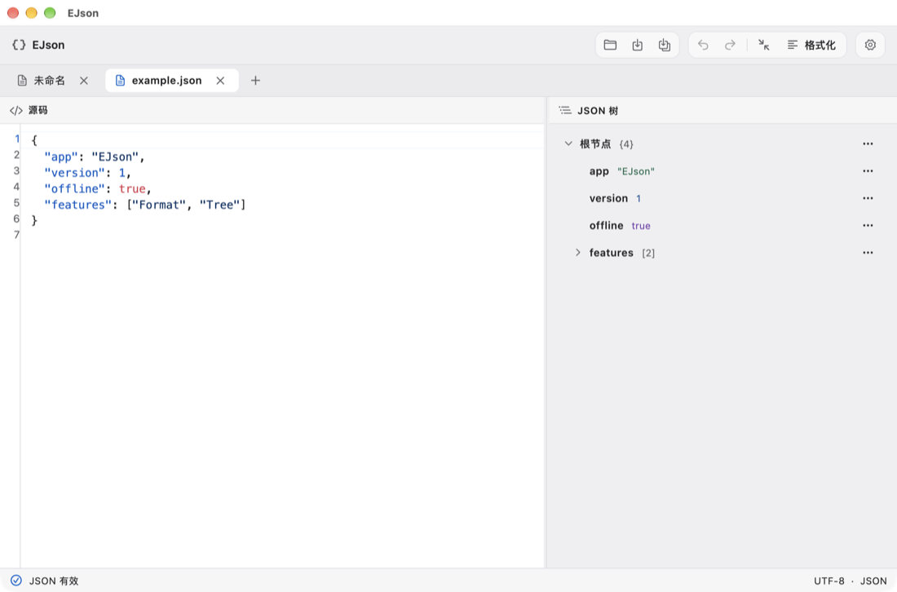

# EJson

[简体中文](README.md) · English

A desktop JSON editor with side-by-side source and tree editing, syntax diagnostics, and workspace restore.

[Website](https://echo-braveshine.github.io/EJson/) · [Download](https://github.com/Echo-BraveShine/EJson/releases/latest) · [Report an issue](https://github.com/Echo-BraveShine/EJson/issues) · [Buy me a coffee](https://buymeacoffee.com/1239383708p)



## Features

| Feature | What it does |
| --- | --- |
| Source editor | Syntax highlighting, line numbers, diagnostic navigation, formatting, and minifying |
| JSON tree | Expand deep nodes, scroll horizontally, focus a subtree, jump to source, rename keys, and replace values |
| Lossless formatting | Preserve duplicate keys, raw numbers, and string escapes |
| Local workspace | Multiple tabs, unsaved-change confirmation, external-change detection, and startup restore |
| Appearance | Light and dark modes, English and Simplified Chinese, and independent editor and tree styles |

Editing and parsing run locally. Checking for updates queries GitHub Releases only on demand. The support button opens Buy Me a Coffee in your browser.

## Install

Choose a package from [GitHub Releases](https://github.com/Echo-BraveShine/EJson/releases/latest).

- **macOS 12+**: Use `EJson-macos-arm64.dmg` for Apple silicon or `EJson-macos-x86_64.dmg` for Intel. Open the DMG and drag EJson into Applications. The universal ZIP and Homebrew build also run natively on both architectures. Apple notarization is pending.
- **Windows x64**: Use `EJson-Windows-x64-Setup.exe` for a per-user install or `EJson-Windows-x64.msi` for an administrator-managed, machine-wide install. Uninstall the existing copy before switching installers. For the portable edition, extract the ZIP and run `ejson.exe`.
- **Linux**: Choose `EJson-linux-x86_64.AppImage` or `EJson-linux-aarch64.AppImage`, make it executable, and open it without administrator permissions. On Fedora or a compatible RPM system, you can also run `sudo dnf install ./EJson-linux-x86_64.rpm` (choose `aarch64` for ARM64). These builds require glibc 2.39 or later, GTK 3, and OpenGL runtime libraries.

```sh
chmod +x EJson-linux-x86_64.AppImage
./EJson-linux-x86_64.AppImage
# If FUSE is unavailable
./EJson-linux-x86_64.AppImage --appimage-extract-and-run
```

On macOS, you can also install with Homebrew.

```sh
brew tap echo-braveshine/ejson https://github.com/Echo-BraveShine/EJson.git
brew install --cask echo-braveshine/ejson/ejson
```

To upgrade, run `brew update` followed by `brew upgrade --cask echo-braveshine/ejson/ejson`.

On Windows, download `EchoBraveShine.EJson.yaml` from the release page to install with WinGet. For first-time use of local manifests, run `winget settings --enable LocalManifestFiles` in an administrator terminal.

```powershell
winget install --manifest .\EchoBraveShine.EJson.yaml
```

On Ubuntu 24.04+ or Debian 13+, download the matching `.deb` from the release page. To upgrade, download and install the newer package.

```sh
sudo apt install ./EJson-linux-amd64.deb
# ARM64
sudo apt install ./EJson-linux-arm64.deb
```

## Development

Install FVM and the Flutter desktop toolchain for your platform, then run:

```sh
fvm install
cd apps/ejson
fvm flutter pub get
fvm flutter run -d macos
```

Use `windows` or `linux` on the corresponding host. The app lives in [apps/ejson](apps/ejson) and the pure Dart JSON engine in [packages/ejson_core](packages/ejson_core). From the repository root, run `fvm flutter analyze --no-pub`, `fvm dart run melos run test:core`, and `fvm dart run melos run test:app`.

## CI, website, and releases

- [Desktop checks](.github/workflows/desktop.yml) runs three-platform checks on branch pushes and pull requests. Release tags trigger the Release workflow.
- [Website](.github/workflows/pages.yml) deploys [website](website) to GitHub Pages. For the first deployment, select GitHub Actions under Settings → Pages. Then open Actions → Website, select `main`, and click Run workflow. Later website changes pushed to `main` trigger deployment.
- [Release](.github/workflows/release.yml) builds installers and portable packages and publishes a GitHub Release when a `vX.Y.Z` tag is pushed. To publish an existing tag, open Actions → Release, select `main`, click Run workflow, and enter the tag. Select `build_only` to build and verify the packages without publishing. The tag must match the tagged source's app version in `apps/ejson/pubspec.yaml` before the `+build` suffix. The app checks the latest stable release.
