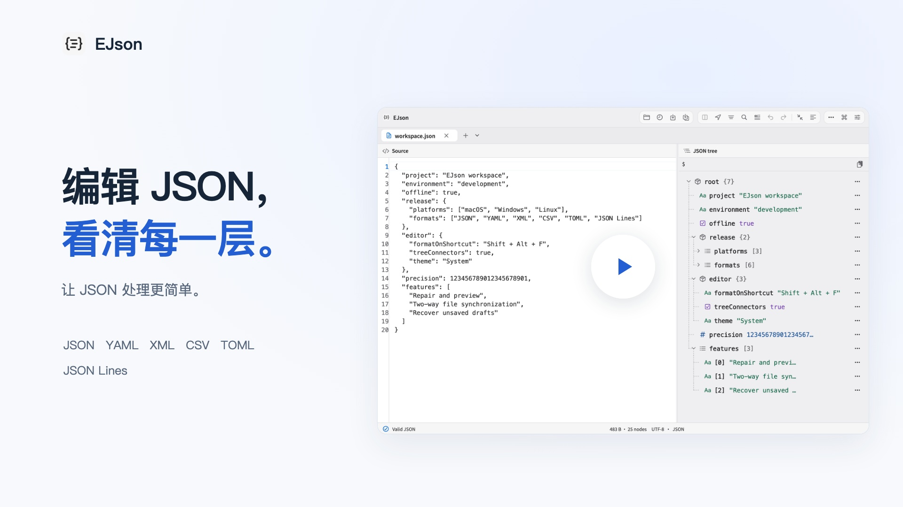
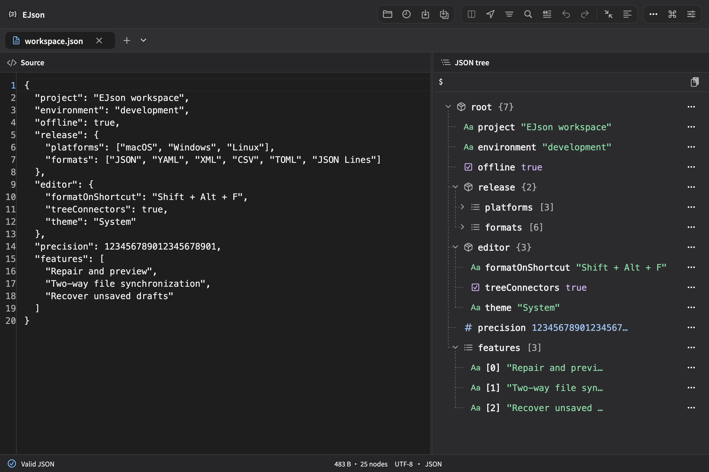
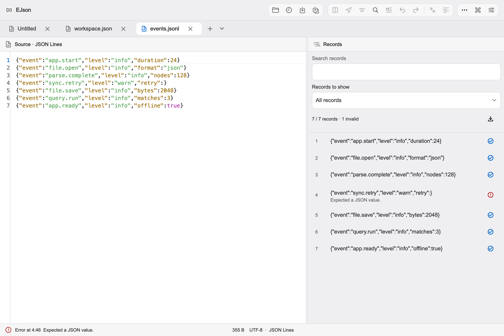
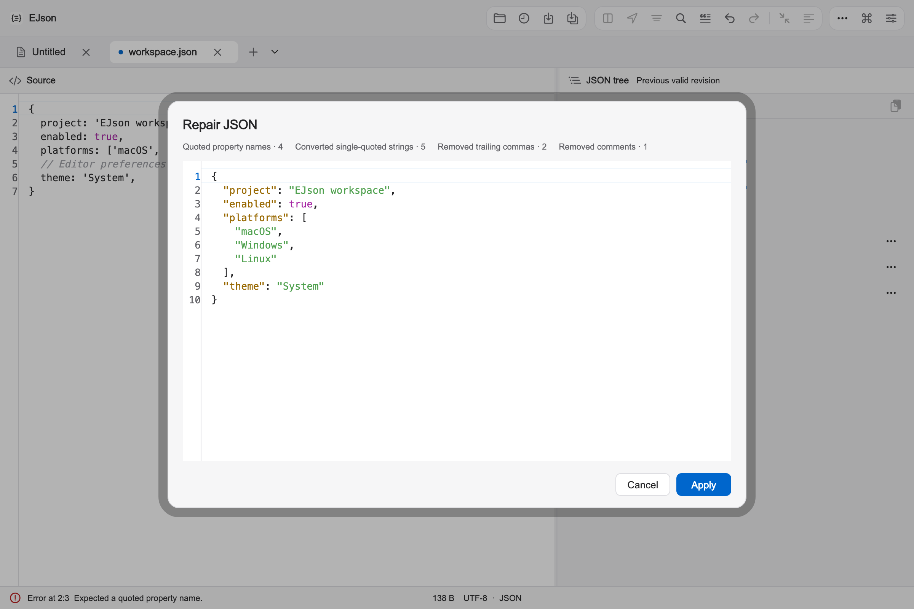
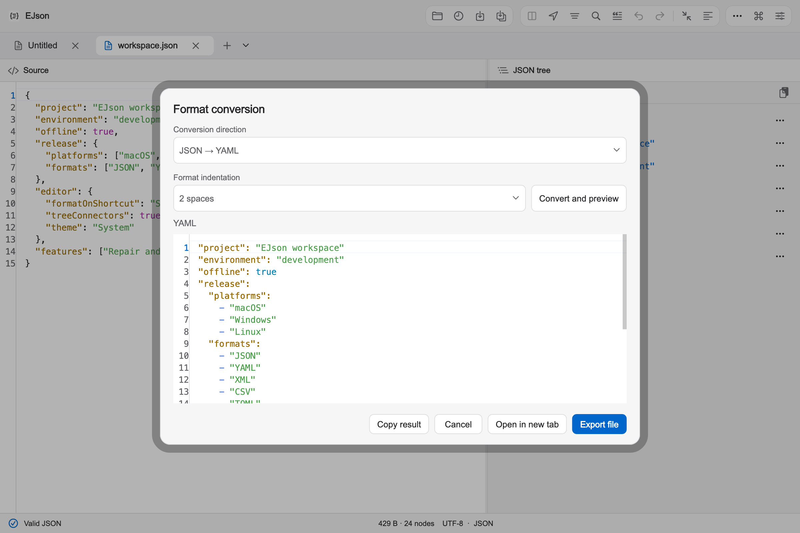
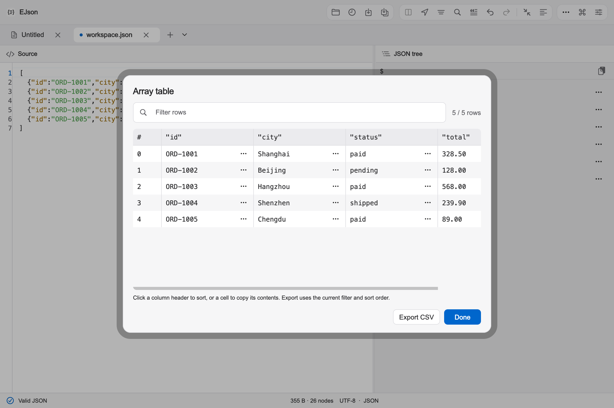
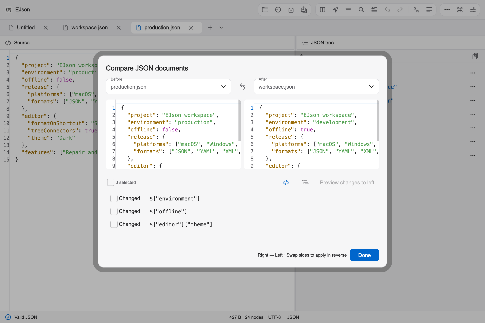
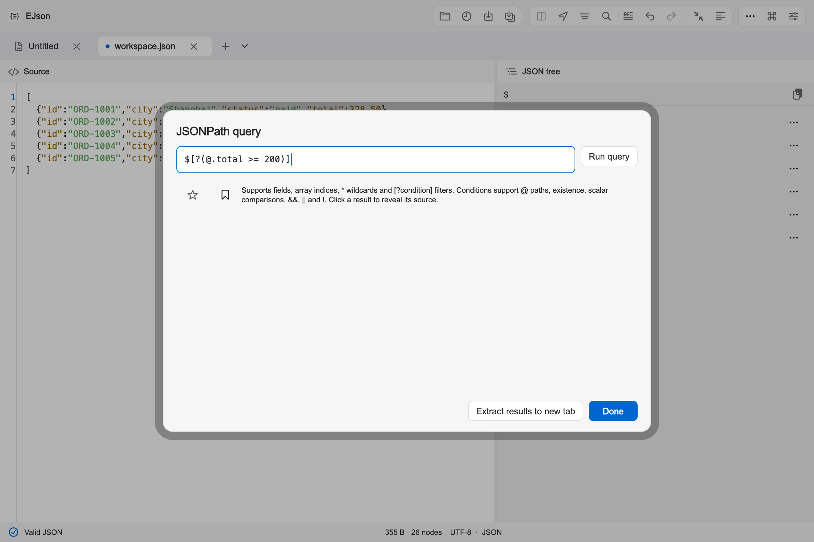
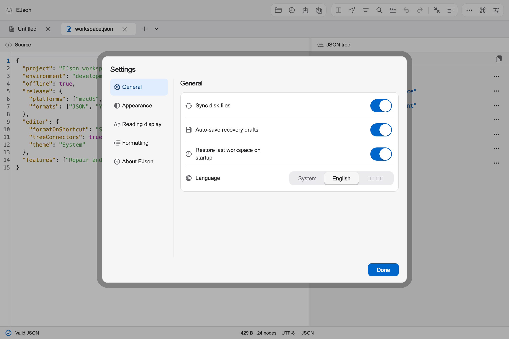

# EJson

[简体中文](README.md) · English

A local desktop workspace for **JSON, YAML, XML, CSV, TOML and JSON Lines**. Edit source and structure, run queries, preview repairs and conversions, and work across multiple tabs.

[Website](https://echo-braveshine.github.io/EJson/) · [Download](https://github.com/Echo-BraveShine/EJson/releases/latest) · [Report an issue](https://github.com/Echo-BraveShine/EJson/issues) · [Buy me a coffee](https://buymeacoffee.com/1239383708p)

<p align="center">
  <a href="https://echo-braveshine.github.io/EJson/en.html#film"></a>
</p>
<p align="center">
  <a href="https://echo-braveshine.github.io/EJson/en.html#film"><strong>▶ Watch the 60-second product film</strong></a> · <a href="website/assets/videos/ejson-promo-60s.mp4">Download MP4</a> · <a href="website/assets/videos/CREDITS.txt">Music credits</a><br>
  <sub>Simplified Chinese captions · 1920 × 1080</sub>
</p>

## Features

| Feature | What it does |
| --- | --- |
| Native document formats | Create, open, edit and save JSON, YAML, XML, CSV, TOML and JSON Lines, including `.jsonl` and `.ndjson` |
| Source and structure | Edit JSON source and tree together, or inspect other structured formats. Expand nodes, scroll horizontally, focus subtrees, reveal source and extract subtrees |
| Dashed hierarchy connectors | Show node connections in JSON trees, structure views and comparison trees. Toggle and persist the setting under Settings → Appearance |
| Lossless formatting | Format and minify JSON while retaining duplicate keys, raw numbers and string escapes, with indentation, line-ending options and a keyboard shortcut |
| JSON repair | Repair trailing commas, single quotes, unquoted keys, comments and missing separators or closing delimiters. Preview repair types and counts, then apply with undo support |
| JSON Lines | Validate and browse records, search text, filter valid or invalid rows, reveal source and export filtered records as JSON Lines or a JSON array |
| Conversion and Save As | Convert between JSON and YAML, XML, CSV, TOML or JSON Lines with previews and compatibility checks. Save in a different format |
| Find and replace | Search source, keys or values with case matching, regular expressions, capture-group replacements and Replace all |
| JSONPath queries | Navigate paths, use wildcards and scalar filters, save queries and extract matches into new tabs |
| Array tools | Table view, filtering, sorting, cell copying and CSV export. Move, duplicate and sort array items by value or field |
| Document comparison | Review added, removed and changed fields, then preview and apply selected structural differences |
| Schema and redaction | Validate JSON Schema and locate issues. Preview redaction by field name or path, then open or export the result |
| Two-way disk synchronization | Save named files after a roughly 500 ms typing pause and reload external changes. Conflicts expose comparison, disk reload, local overwrite and Save As actions |
| Recovery drafts | Save after 2 idle seconds and at most 10 seconds apart during continuous editing. Recover content, tab order and selection after unexpected exits, with rotating snapshot fallback |
| Files and workspace | Multiple tabs, file-manager opening, multi-file drag and drop and startup restore. Search and manage the 20 most recent files |
| Reading and appearance | Light and dark modes, English and Simplified Chinese, local fonts, text size, line spacing and independent editor and tree styles with live previews |
| Commands and statistics | English and Chinese command search, undo, redo, string escape and unescape, byte count, node count, maximum depth and longest-array statistics |

## Screenshots

These screenshots render the current Flutter interface with sample data. Select an image to open the original.

<table>
<tr><td width="50%"><strong>Dark workbench and hierarchy connectors</strong><br><a href="website/assets/workbench-dark.png"></a></td><td width="50%"><strong>JSON Lines validation and filtering</strong><br><a href="website/assets/json-lines.png"></a></td></tr>
<tr><td><strong>JSON repair preview</strong><br><a href="website/assets/repair.png"></a></td><td><strong>Format conversion preview</strong><br><a href="website/assets/conversion.png"></a></td></tr>
<tr><td><strong>Array tables</strong><br><a href="website/assets/arrays.png"></a></td><td><strong>Structural comparison</strong><br><a href="website/assets/comparison.png"></a></td></tr>
<tr><td><strong>JSONPath filters</strong><br><a href="website/assets/query.png"></a></td><td><strong>Synchronization and recovery settings</strong><br><a href="website/assets/settings.png"></a></td></tr>
</table>

## Saving, synchronization and recovery

- Disk synchronization and recovery draft auto-save are enabled by default. Toggle them separately under Settings → General. Named files save edits including incomplete syntax. Unnamed documents save as recovery drafts.
- Concurrent local and external changes pause synchronization until you choose a resolution. Repairs and conversions offer previews. Applied repairs participate in enabled disk synchronization.
- Each JSON Lines record is one JSON value. Blank lines are invalid. Converting to JSON produces an array, and exporting a JSON array to JSON Lines writes one element per line.
- The file limit is 16 MiB. Documents over 2,097,152 UTF-16 code units open read-only. JSON Lines still supports record browsing, filtering and export.

Editing and parsing run locally. Checking for updates queries GitHub Releases on demand. The support button opens Buy Me a Coffee in your browser.

## Keyboard shortcuts

| Action | macOS | Windows / Linux |
| --- | --- | --- |
| Format document | `Shift+Option+F` | `Shift+Alt+F` |
| Command palette | `Cmd+Shift+P` | `Ctrl+Shift+P` |
| Recent files | `Cmd+P` | `Ctrl+P` |
| Find and replace | `Cmd+F` | `Ctrl+F` |
| Open files | `Cmd+O` | `Ctrl+O` |
| Save / Save As | `Cmd+S` / `Cmd+Shift+S` | `Ctrl+S` / `Ctrl+Shift+S` |
| Undo / Redo | `Cmd+Z` / `Cmd+Shift+Z` | `Ctrl+Z` / `Ctrl+Shift+Z` |
| New / Close tab | `Cmd+N` / `Cmd+W` | `Ctrl+N` / `Ctrl+W` |

Drop multiple local files onto the workbench to open them. Opening a file again switches to its existing tab. Temporary dropped copies open as new documents.

## Install

Choose a package from [GitHub Releases](https://github.com/Echo-BraveShine/EJson/releases/latest).

- **macOS 12+**: Use `EJson-macos-arm64.dmg` for Apple silicon or `EJson-macos-x86_64.dmg` for Intel. Open the DMG and drag EJson into Applications. The universal ZIP and Homebrew build also run natively on both architectures. Apple notarization is pending.
- **Windows x64**: Use `EJson-Windows-x64-Setup.exe` for a per-user install or `EJson-Windows-x64.msi` for an administrator-managed, machine-wide install. Uninstall the existing copy before switching installers. For the portable edition, extract the ZIP and run `ejson.exe`.
- **Linux**: Choose `EJson-linux-x86_64.AppImage` or `EJson-linux-aarch64.AppImage`, make it executable, and open it without administrator permissions. On Fedora or a compatible RPM system, you can also run `sudo dnf install ./EJson-linux-x86_64.rpm` (choose `aarch64` for ARM64). These builds require glibc 2.39 or later, GTK 3, and OpenGL runtime libraries.

```sh
chmod +x EJson-linux-x86_64.AppImage
./EJson-linux-x86_64.AppImage
# If FUSE is unavailable
./EJson-linux-x86_64.AppImage --appimage-extract-and-run
```

On macOS, you can also install with Homebrew.

```sh
brew tap echo-braveshine/ejson https://github.com/Echo-BraveShine/EJson.git
brew install --cask echo-braveshine/ejson/ejson
```

To upgrade, run `brew update` followed by `brew upgrade --cask echo-braveshine/ejson/ejson`.

On Windows, download `EchoBraveShine.EJson.yaml` from the release page to install with WinGet. For first-time use of local manifests, run `winget settings --enable LocalManifestFiles` in an administrator terminal.

```powershell
winget install --manifest .\EchoBraveShine.EJson.yaml
```

On Ubuntu 24.04+ or Debian 13+, download the matching `.deb` from the release page. To upgrade, download and install the newer package.

```sh
sudo apt install ./EJson-linux-amd64.deb
# ARM64
sudo apt install ./EJson-linux-arm64.deb
```

After installation, choose EJson from Open With for `.json`, `.yaml`, `.yml`, `.xml`, `.csv`, `.toml`, `.jsonl` or `.ndjson` files. Set EJson as the default app for a file type to open it with a double-click.

## Development

Install FVM and the Flutter desktop toolchain for your platform, then run:

```sh
fvm install
cd apps/ejson
fvm flutter pub get
fvm flutter run -d macos
```

Use `windows` or `linux` on the corresponding host. The app lives in [apps/ejson](apps/ejson) and the pure Dart JSON engine in [packages/ejson_core](packages/ejson_core). From the repository root, run `fvm flutter analyze --no-pub`, `fvm dart run melos run test:core`, and `fvm dart run melos run test:app`.

## CI, website, and releases

- [Desktop checks](.github/workflows/desktop.yml) runs three-platform checks on branch pushes and pull requests. Release tags trigger the Release workflow.
- [Website](.github/workflows/pages.yml) deploys [website](website) to GitHub Pages. For the first deployment, select GitHub Actions under Settings → Pages. Then open Actions → Website, select `main`, and click Run workflow. Later website changes pushed to `main` trigger deployment.
- [Release](.github/workflows/release.yml) builds installers and portable packages and publishes a GitHub Release when a `vX.Y.Z` tag is pushed. To publish an existing tag, open Actions → Release, select `main`, click Run workflow, and enter the tag. Select `build_only` to build and verify the packages without publishing. The tag must match the tagged source's app version in `apps/ejson/pubspec.yaml` before the `+build` suffix. The app checks the latest stable release.
