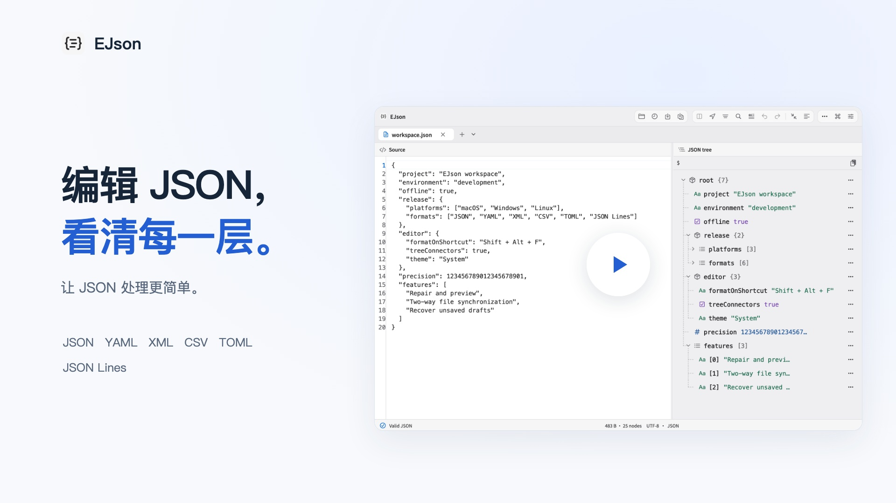
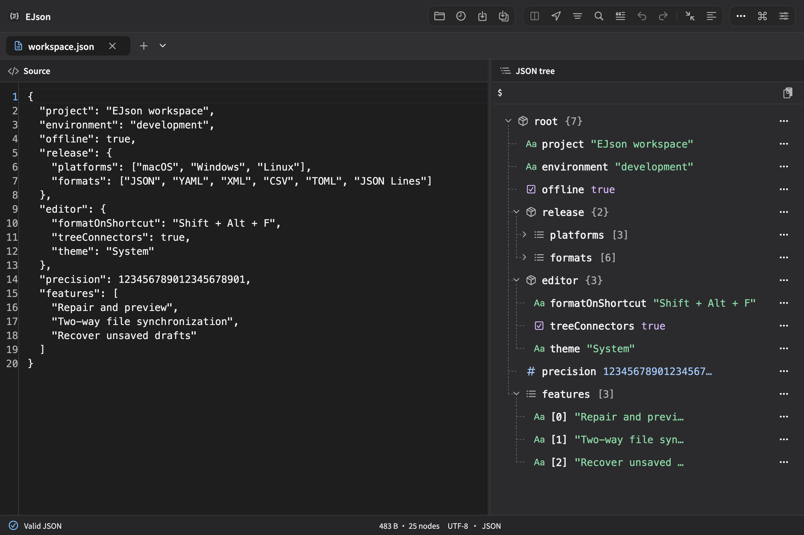
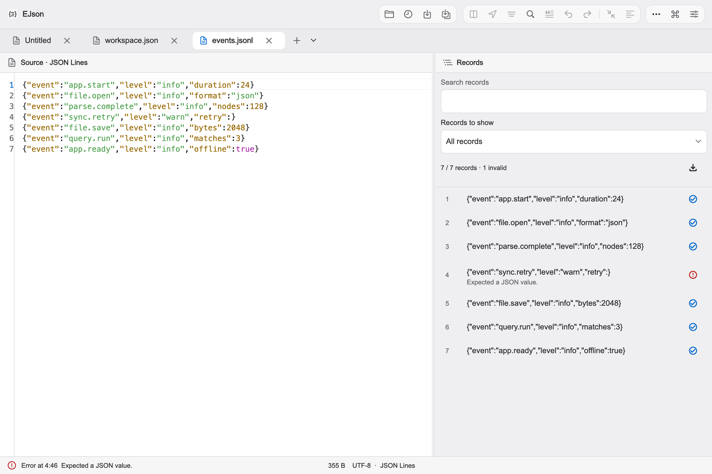
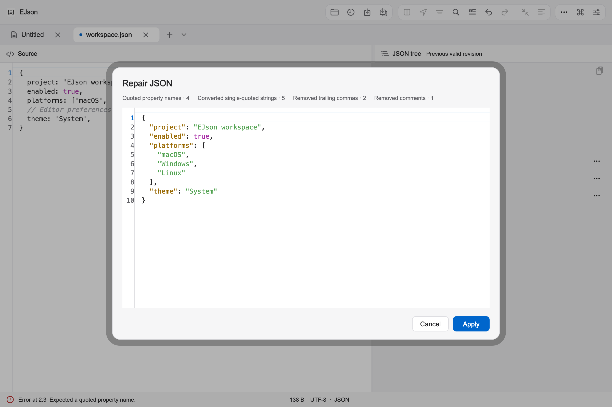
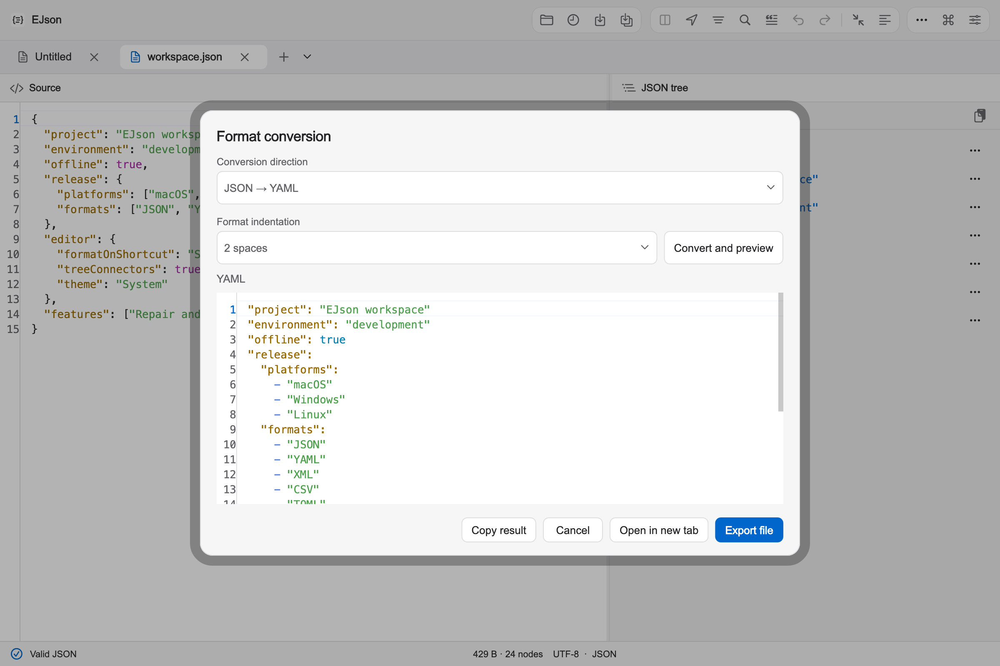
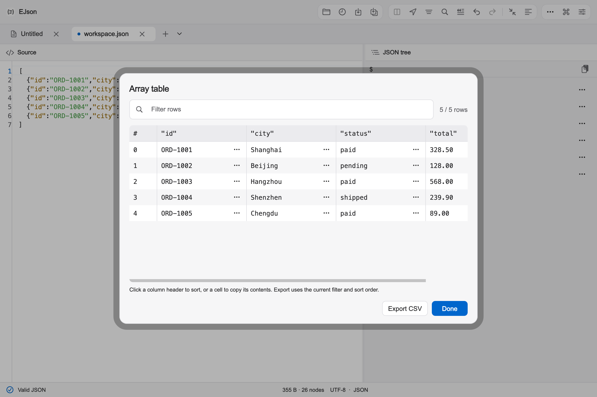
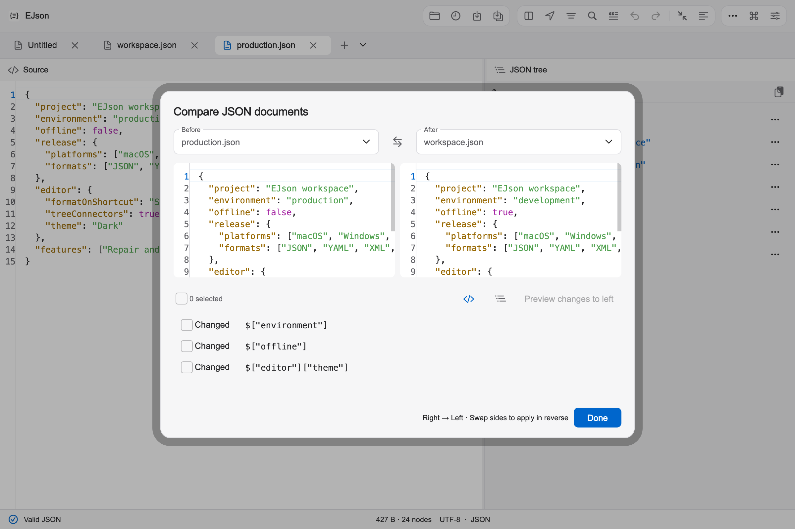
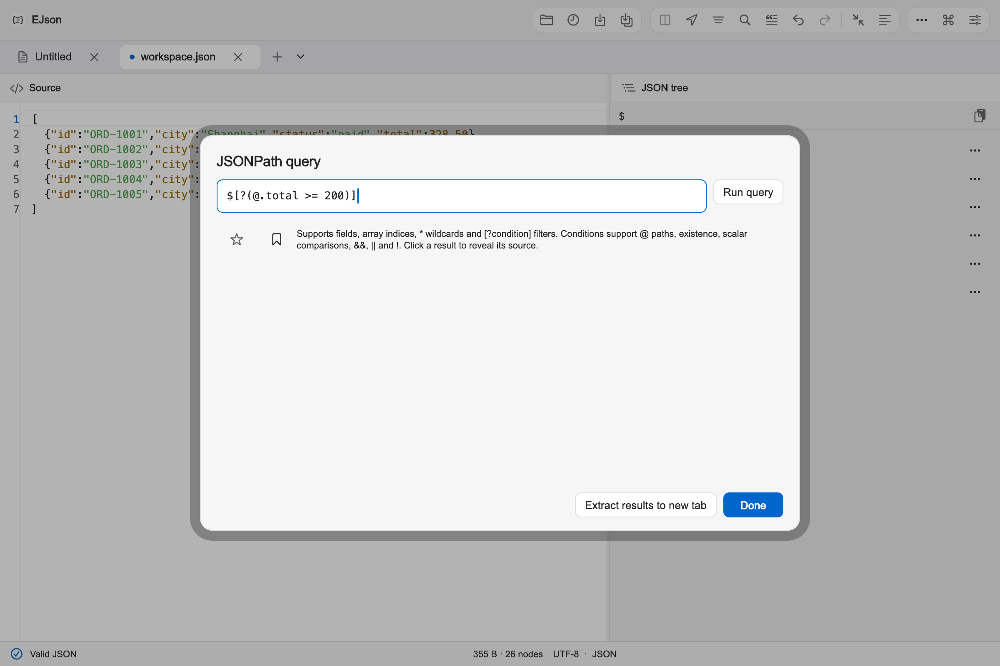
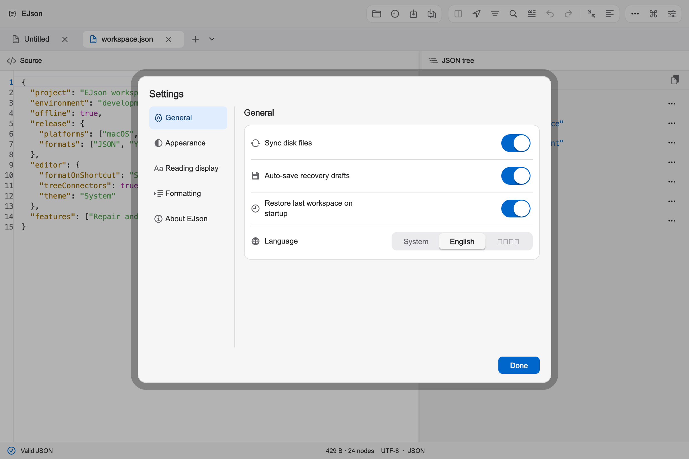

# EJson

简体中文 · [English](README.en.md)

本地桌面数据工作台。支持 **JSON、YAML、XML、CSV、TOML 和 JSON Lines**，把源码、层级结构、查询、修复和转换放在同一个多标签工作区。

[官方网站](https://echo-braveshine.github.io/EJson/) · [下载](https://github.com/Echo-BraveShine/EJson/releases/latest) · [问题反馈](https://github.com/Echo-BraveShine/EJson/issues) · [请我喝杯咖啡](https://buymeacoffee.com/1239383708p)

<p align="center">
  <a href="https://echo-braveshine.github.io/EJson/#film"></a>
</p>
<p align="center">
  <a href="https://echo-braveshine.github.io/EJson/#film"><strong>▶ 观看 60 秒产品影片</strong></a> · <a href="website/assets/videos/ejson-promo-60s.mp4">下载 MP4</a> · <a href="website/assets/videos/CREDITS.txt">音乐署名</a><br>
  <sub>简体中文字幕 · 1920 × 1080</sub>
</p>

## 功能

| 功能 | 说明 |
| --- | --- |
| 多格式文档 | 新建、打开、编辑和保存 JSON、YAML、XML、CSV、TOML、JSON Lines，识别 `.jsonl` 与 `.ndjson` |
| 源码与层级结构 | JSON 源码与树双向编辑，其他结构格式提供结构视图。支持展开节点、横向滚动、聚焦子树、定位源码及提取子树 |
| 层级虚线 | JSON 树、结构树和比较视图可显示节点连接虚线，在「设置 → 外观 → 树状层级虚线」中切换并保存选择 |
| 无损格式化 | JSON 格式化和压缩保留重复键、数字原文及字符串转义，可选择缩进和换行符，支持格式化快捷键 |
| JSON 修复 | 修复尾逗号、单引号、未加引号的键、注释、缺少的分隔符与闭合符号。预览修复类型和次数，确认后应用，支持撤销 |
| JSON Lines | 按行校验和浏览日志，搜索记录、筛选有效或无效行，点击记录定位源码，将筛选结果导出为 JSON Lines 或 JSON 数组 |
| 格式转换与另存为 | JSON 与 YAML、XML、CSV、TOML、JSON Lines 相互转换，提供结果预览及兼容性校验，支持跨格式另存为 |
| 查找与替换 | 搜索源码、键或值，支持区分大小写、正则表达式、捕获组替换和全部替换 |
| JSONPath 查询 | 路径定位、通配符、标量条件筛选、收藏查询及提取结果到新标签 |
| 数组工具 | 表格查看、筛选、排序、复制单元格和导出 CSV，支持数组项移动、复制及按值或字段排序 |
| 文档比较 | 检查新增、移除和修改的字段，预览并应用选中的结构差异 |
| Schema 与脱敏 | JSON Schema 校验和错误定位，按字段名或路径预览脱敏结果，再打开或导出 |
| 磁盘双向同步 | 停止输入约 500 毫秒后自动写入已命名文件，自动加载外部修改，冲突时提供对照查看、加载磁盘版本、保留本地修改及另存为 |
| 恢复草稿 | 停止编辑 2 秒后自动保存恢复草稿，持续编辑时最多间隔 10 秒。异常退出后恢复内容、标签顺序和选中标签，轮换快照支持损坏回退 |
| 文件与工作区 | 多标签、多文件拖入、从文件管理器打开、启动恢复，最近文件保留 20 条并支持搜索及清理 |
| 阅读与外观 | 浅色与深色、中英文、本机字体、字号、行距，独立的源码高亮和树样式，实时预览 |
| 命令与统计 | 中英文命令搜索、撤销重做、字符串转义与反转义，以及字节数、节点数、最大深度和最长数组统计 |

## 界面预览

以下截图由当前 App 的实际 Flutter 界面使用示例数据渲染。点击图片可查看原图。

<table>
<tr><td width="50%"><strong>深色工作台与层级虚线</strong><br><a href="website/assets/workbench-dark.png"></a></td><td width="50%"><strong>JSON Lines 逐行校验与筛选</strong><br><a href="website/assets/json-lines.png"></a></td></tr>
<tr><td><strong>JSON 自动修复预览</strong><br><a href="website/assets/repair.png"></a></td><td><strong>多格式转换预览</strong><br><a href="website/assets/conversion.png"></a></td></tr>
<tr><td><strong>数组表格</strong><br><a href="website/assets/arrays.png"></a></td><td><strong>结构差异比较</strong><br><a href="website/assets/comparison.png"></a></td></tr>
<tr><td><strong>JSONPath 条件查询</strong><br><a href="website/assets/query.png"></a></td><td><strong>同步与恢复设置</strong><br><a href="website/assets/settings.png"></a></td></tr>
</table>

## 保存、同步与恢复

- 磁盘文件双向同步和恢复草稿默认开启，可在「设置 → 通用」中分别切换。已命名文件会同步写入语法尚未完成的编辑内容，未命名文档会保存为恢复草稿。
- 外部修改与本地修改发生冲突时暂停同步，由用户选择处理方式。JSON 修复和格式转换都提供预览，应用修复后的内容会参与已开启的磁盘同步。
- JSON Lines 每行包含一个 JSON 值，空白行标记为无效。转换为 JSON 时生成数组，JSON 数组导出为 JSON Lines 时每个元素占一行。
- 单文件上限为 16 MiB。文档超过 2,097,152 个 UTF-16 代码单元时采用只读模式，JSON Lines 仍支持逐行浏览、筛选和导出。

编辑和解析在本机完成。「检查版本更新」仅在主动点击后查询 GitHub Releases；「请我喝杯咖啡」在浏览器打开赞助页面。

## 快捷键

| 操作 | macOS | Windows / Linux |
| --- | --- | --- |
| 格式化当前文档 | `Shift+Option+F` | `Shift+Alt+F` |
| 命令面板 | `Cmd+Shift+P` | `Ctrl+Shift+P` |
| 最近文件 | `Cmd+P` | `Ctrl+P` |
| 查找与替换 | `Cmd+F` | `Ctrl+F` |
| 打开文件 | `Cmd+O` | `Ctrl+O` |
| 保存 / 另存为 | `Cmd+S` / `Cmd+Shift+S` | `Ctrl+S` / `Ctrl+Shift+S` |
| 撤销 / 重做 | `Cmd+Z` / `Cmd+Shift+Z` | `Ctrl+Z` / `Ctrl+Shift+Z` |
| 新建 / 关闭标签 | `Cmd+N` / `Cmd+W` | `Ctrl+N` / `Ctrl+W` |

将多个本地文件拖入工作台可逐个打开，重复打开同一文件时切换到已有标签。临时拖入副本会作为新文档打开。

## 安装

从 [GitHub Releases](https://github.com/Echo-BraveShine/EJson/releases/latest) 选择对应平台的下载包。

- **macOS 12+**：Apple Silicon（M 系列）选择 `EJson-macos-arm64.dmg`，Intel Mac 选择 `EJson-macos-x86_64.dmg`。打开 DMG，将 EJson 拖入「应用程序」。通用 ZIP 和 Homebrew 构建也支持两种架构，可在 M 系列上原生运行。GitHub Actions 构建未经过 Apple 公证。
- **Windows x64**：双击 `EJson-Windows-x64-Setup.exe` 为当前用户安装，或用 `EJson-Windows-x64.msi` 为整台电脑安装。MSI 需要管理员权限。从一种安装方式切换到另一种前，先卸载旧安装。便携版可解压 ZIP 后运行 `ejson.exe`。
- **Linux**：按架构选择 `EJson-linux-x86_64.AppImage` 或 `EJson-linux-aarch64.AppImage`，赋予执行权限后双击或在终端运行，无需管理员权限。Fedora 或兼容的 RPM 系统也可用 `sudo dnf install ./EJson-linux-x86_64.rpm`（ARM64 选择 `aarch64`）。这些构建需要 glibc 2.39 或更新版本、GTK 3 和 OpenGL 运行库。

```sh
chmod +x EJson-linux-x86_64.AppImage
./EJson-linux-x86_64.AppImage
# 系统没有 FUSE 时，从终端启动
./EJson-linux-x86_64.AppImage --appimage-extract-and-run
```

macOS 也可以使用 Homebrew 安装。

```sh
brew tap echo-braveshine/ejson https://github.com/Echo-BraveShine/EJson.git
brew install --cask echo-braveshine/ejson/ejson
```

升级时先运行 `brew update`，再运行 `brew upgrade --cask echo-braveshine/ejson/ejson`。

Windows 可在发布页下载 `EchoBraveShine.EJson.yaml` 后使用 WinGet 安装。首次使用本地清单时，需在管理员终端运行 `winget settings --enable LocalManifestFiles`。

```powershell
winget install --manifest .\EchoBraveShine.EJson.yaml
```

Ubuntu 24.04+ 或 Debian 13+ 用户可运行 `dpkg --print-architecture`，然后从发布页下载对应架构的 `.deb`。升级时下载新版包并重复安装。

```sh
# amd64
sudo apt install ./EJson-linux-amd64.deb
# arm64（例如 Apple 芯片 Mac 上的 ARM Linux 虚拟机）
sudo apt install ./EJson-linux-arm64.deb
```

安装后可在支持格式文件的「打开方式」中选择 EJson，包括 `.json`、`.yaml`、`.yml`、`.xml`、`.csv`、`.toml`、`.jsonl` 和 `.ndjson`。设为默认应用后即可双击打开。

## 本地开发

安装 FVM 和目标平台的 Flutter 桌面工具链，然后运行：

```sh
fvm install
cd apps/ejson
fvm flutter pub get
fvm flutter run -d macos
```

在对应平台上可将设备改为 `windows` 或 `linux`。应用位于 [apps/ejson](apps/ejson)，纯 Dart JSON 核心位于 [packages/ejson_core](packages/ejson_core)。从仓库根目录运行 `fvm flutter analyze --no-pub`、`fvm dart run melos run test:core` 和 `fvm dart run melos run test:app`。

## CI、官网与发版

- [Desktop checks](.github/workflows/desktop.yml) 在分支推送和 Pull Request 时运行三平台检查。发布标签触发 Release。
- [Website](.github/workflows/pages.yml) 将 [website](website) 部署到 GitHub Pages。首次部署时，在仓库「Settings → Pages」将来源设为「GitHub Actions」，然后到「Actions → Website」选择 `main` 并点击「Run workflow」。之后推送到 `main` 的网站改动会触发部署。
- [Release](.github/workflows/release.yml) 在推送 `vX.Y.Z` 标签时构建安装包和便携包并创建 GitHub Release。已有标签可在「Actions → Release」选择 `main`，点击「Run workflow」并填写标签来补发，也可勾选 `build_only` 只构建并检查安装包。标签须与对应源码的 `apps/ejson/pubspec.yaml` 版本一致，忽略 `+build` 部分。应用内检查更新读取最新正式 Release。
