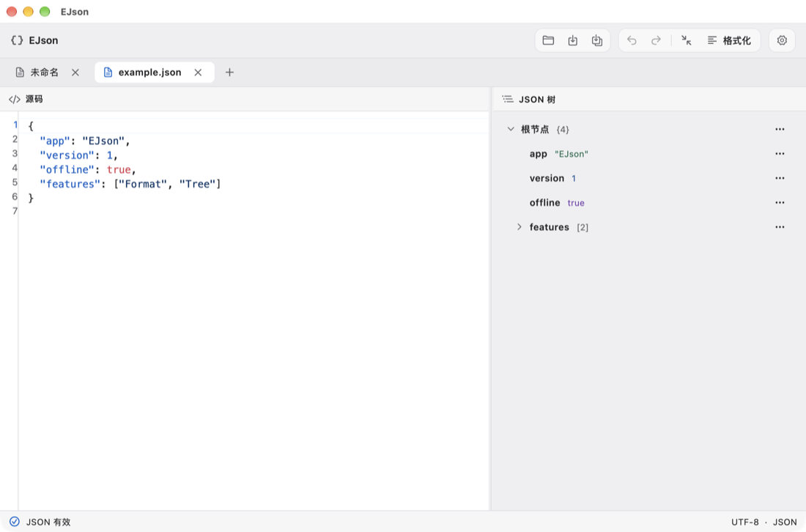

# EJson

简体中文 · [English](README.en.md)

在桌面上编辑 JSON。源码和树形结构同屏，支持双向编辑、错误定位和工作区恢复。

[官方网站](https://echo-braveshine.github.io/EJson/) · [下载](https://github.com/Echo-BraveShine/EJson/releases/latest) · [问题反馈](https://github.com/Echo-BraveShine/EJson/issues) · [请我喝杯咖啡](https://buymeacoffee.com/1239383708p)



## 功能

| 功能 | 说明 |
| --- | --- |
| 源码编辑 | 语法高亮、行号、校验、错误跳转、格式化和压缩 |
| JSON 树 | 展开深层节点、横向滚动、聚焦子树、定位源码、重命名键和替换值 |
| 无损格式化 | 保留重复键、数字原文和字符串转义 |
| 本地工作区 | 多标签、未保存确认、外部文件修改检测和启动恢复 |
| 外观 | 浅色、深色、中英文、独立的源码高亮与树样式 |

编辑和解析在本机完成。「检查版本更新」仅在主动点击后查询 GitHub Releases；「请我喝杯咖啡」在浏览器打开赞助页面。

## 安装

从 [GitHub Releases](https://github.com/Echo-BraveShine/EJson/releases/latest) 选择对应平台的下载包。

- **macOS 12+**：解压 ZIP，将 `EJson.app` 移到「应用程序」。GitHub Actions 生成的构建未进行 Apple 公证。
- **Windows**：双击 `EJson-Windows-x64-Setup.exe` 安装，从开始菜单启动 EJson。便携版可解压 ZIP 后运行 `ejson.exe`。
- **Linux**：解压 `.tar.gz`，从解压目录运行 `./ejson`。系统需要 GTK 3。

macOS 也可以使用 Homebrew 安装。

```sh
brew tap echo-braveshine/ejson https://github.com/Echo-BraveShine/EJson.git
brew install --cask echo-braveshine/ejson/ejson
```

升级时先运行 `brew update`，再运行 `brew upgrade --cask echo-braveshine/ejson/ejson`。

Windows 可在发布页下载 `EchoBraveShine.EJson.yaml` 后使用 WinGet 安装。首次使用本地清单时，需在管理员终端运行 `winget settings --enable LocalManifestFiles`。

```powershell
winget install --manifest .\EchoBraveShine.EJson.yaml
```

Ubuntu 24.04+ 或 Debian 13+ 的 x64 用户可从发布页下载 `.deb`，然后运行以下命令。升级时下载新版包并重复安装。

```sh
sudo apt install ./EJson-linux-amd64.deb
```

## 本地开发

安装 FVM 和目标平台的 Flutter 桌面工具链，然后运行：

```sh
fvm install
cd apps/ejson
fvm flutter pub get
fvm flutter run -d macos
```

在对应平台上可将设备改为 `windows` 或 `linux`。应用位于 [apps/ejson](apps/ejson)，纯 Dart JSON 核心位于 [packages/ejson_core](packages/ejson_core)。从仓库根目录运行 `fvm flutter analyze --no-pub`、`fvm dart run melos run test:core` 和 `fvm dart run melos run test:app`。

## CI、官网与发版

- [Desktop checks](.github/workflows/desktop.yml) 在三个平台检查格式、静态分析、测试和原生构建。
- [Website](.github/workflows/pages.yml) 将 [website](website) 部署到 GitHub Pages。首次部署时，在仓库「Settings → Pages」将来源设为「GitHub Actions」，然后到「Actions → Website」选择 `main` 并点击「Run workflow」。之后推送到 `main` 的网站改动会触发部署。
- [Release](.github/workflows/release.yml) 在推送 `vX.Y.Z` 标签时构建三平台压缩包并创建 GitHub Release。已有标签可在「Actions → Release」选择 `main`，点击「Run workflow」并填写标签来补发。构建使用标签对应的源码，标签须与该版本 `apps/ejson/pubspec.yaml` 中的版本一致，忽略 `+build` 部分。应用内检查更新读取最新正式 Release。
